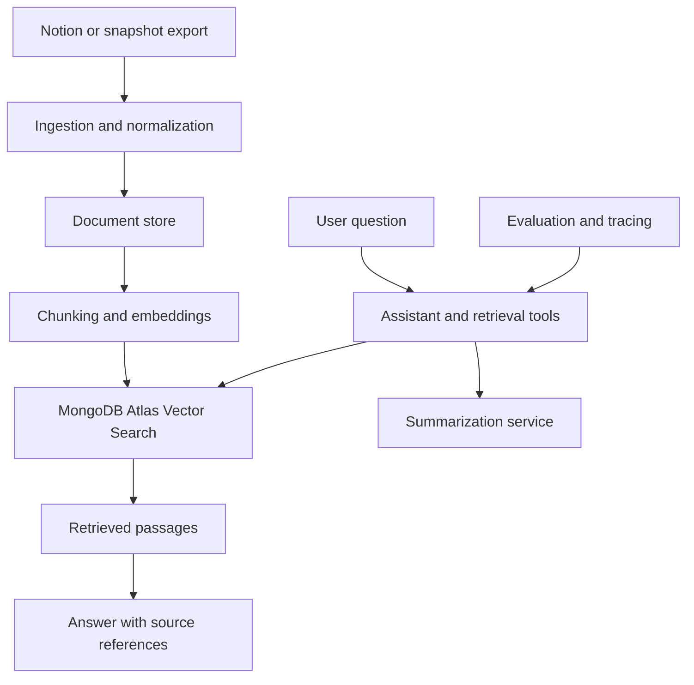

Second Brain AI Assistant
An AI research assistant designed to help people find, connect, and summarize information from their personal knowledge base. The project focuses on a Notion-backed workflow: ingest notes and linked resources, index their content, and let users ask questions through a retrieval-augmented assistant.
Project status: Architecture and implementation roadmap. The components below describe the intended system; they should not be read as claims that every pipeline or integration is already implemented.

Why this project
Personal notes often contain useful answers, but finding them can mean searching across pages, links, and long documents. This project explores a “second brain” interface that can retrieve relevant passages from a user's own material and synthesize an answer with sources for follow-up.

The goal is to build the system in stages, from reliable ingestion and retrieval to agent workflows and operational tooling. The initial data source is Notion, with support for exported snapshots as a possible alternative.
Planned capabilities
- Import pages and content from Notion or a snapshot export.
- Normalize documents to Markdown and optionally crawl linked resources.
- Store source documents and metadata in MongoDB.
- Chunk and embed content for MongoDB Atlas Vector Search.
- Combine semantic retrieval with keyword search to improve recall.
- Answer questions using retrieved context and show the supporting sources.
- Add summarization workflows for long notes and retrieved passages.
- Add a tool-using assistant for retrieval and summarization tasks.
- Track experiments and evaluate retrieval and answer quality as the system matures.
Intended architecture
The design separates offline processing from online question answering. Offline pipelines prepare and index knowledge; online services retrieve relevant passages and compose answers.

Offline workflows
1. Collect pages from Notion or load a local export.
2. Normalize text and metadata; optionally fetch linked pages and web resources.
3. Apply configurable quality checks and retain source information.
4. Chunk documents, create embeddings, and update the vector and text indexes.
5. Build evaluation examples from representative questions and expected sources.
Online workflow
1. The user asks a question through an interface such as a Gradio app.
2. The assistant retrieves relevant chunks through semantic and keyword search.
3. A language model synthesizes an answer from the retrieved material.
4. The response includes source references so the user can inspect the original notes.
5. Traces and evaluation results help identify retrieval or answer-quality issues.
Technology under consideration
Area	Candidate tools
Language and project tooling	Python, uv, Ruff
Knowledge source	Notion API, exported snapshots
Document processing	Markdown normalization, Crawl4AI for linked content
Storage and retrieval	MongoDB, MongoDB Atlas Vector Search, hybrid search
Models	Open-source LLMs such as Llama for fine-tuned summarization; hosted models where appropriate
Fine-tuning	Unsloth
Data and model registries	Hugging Face Datasets and Model Hub
Agent interface	Hugging Face smolagents; selective LangChain integrations
Pipelines and tracking	ZenML, Comet
Observability and evaluation	Opik
Inference and UI	Hugging Face Dedicated Endpoints, optional Gradio interface

These are design candidates, not a finalized dependency list. The implementation should adopt tools as needed rather than requiring the entire stack from the start.
Roadmap
- [ ] Define the initial document schema and local configuration.
- [ ] Build a repeatable Notion or snapshot ingestion workflow.
- [ ] Normalize and chunk documents while preserving source metadata.
- [ ] Implement a baseline retriever and source-grounded question answering.
- [ ] Add hybrid search and evaluate retrieval quality.
- [ ] Add summarization and compare a fine-tuned model with a baseline.
- [ ] Add an agent interface with retrieval and summarization tools.
- [ ] Add tracing, evaluation, and pipeline orchestration.
- [ ] Add a simple user interface and document deployment requirements.
Design principles
- Ground answers in personal data: Responses should be based on retrieved notes, with links or identifiers to the sources.
- Keep ingestion repeatable: Re-running a pipeline should not create duplicate or inconsistent records.
- Separate offline and online work: Indexing and training should not be coupled to interactive requests.
- Evaluate before adding complexity: Measure retrieval and answer quality before adopting fine-tuning or multi-step agents.
- Protect private knowledge: Credentials and personal content should stay out of source control and logs unless explicitly configured.
Setup and usage
The project brief does not yet define a runnable repository structure, dependency lockfile, or implemented command-line interface. Setup and usage instructions will be added once the first ingestion and retrieval workflow is in place.

When integrations are added, credentials should be supplied through environment variables or a secrets manager. Do not commit Notion tokens, database connection strings, model-provider keys, or private notes to GitHub.
Privacy and limitations
This assistant is intended to handle private knowledge, so data access, retention, and logging need to be designed deliberately. A production deployment should document which services receive note content, how long content and traces are retained, and how users can remove indexed data.

Generated summaries and answers can omit context or misread a source. Users should be able to inspect the retrieved notes, especially when the information affects important decisions.
